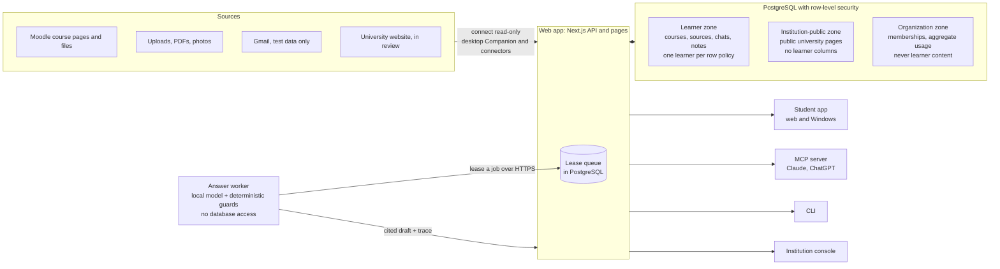

# Neyvu

Neyvu is an AI learning layer for students. You ask one question across the places you learn (your course site, your files, your notes) and get an answer that cites the exact source it came from. If Neyvu can't find support for something, it says so instead of guessing.

It is built for students first. Neyvu only reads sources. It never submits work, posts or sends messages, and it never treats a deadline as proof that something was submitted or graded.

This repository is a public snapshot of the web app, the answer worker and the deterministic guards, prepared for the Cognizant BrAInstorm Challenge (November 2026). It is a single commit taken from the private repository. The private evaluation corpus, deployment configuration and operations documents are left out (see [What this repo leaves out](#what-this-repo-leaves-out)).

## Status

| Live | Built, awaiting access | Planned |
|---|---|---|
| Approved Acadia University students on the web and on Windows | MCP server so Claude and ChatGPT can read a student's verified context | University website as a source (in review) |
| Moodle through the desktop Companion | Moodle web-services sign-in | Grades and "what if" scenarios |
| Course chats with cited answers | Gmail reader (tested on test data only) | Canvas and Brightspace |
| Deterministic guards on every answer | | Outlook and calendars |
| Answer trace recorded for every answer | "Why this answer" view for students (not yet visible to them) | Canadian hosting |
| English and Spanish | | |

"Built, awaiting access" means the code is here, but the feature needs an institution or provider to grant access before students can use it.

## Architecture



- **Sources come in read-only.** Moodle at Acadia has no student API, so the desktop Companion (`companion/`) reads the pages a student can already see in their own signed-in browser and uploads them. Connectors for Moodle web services, Canvas, Brightspace and mail live in `packages/connectors/` and use read-only scopes.
- **Every source is versioned.** A changed file gets a new version with its hash, and answers cite a specific version.
- **The web app owns the data; the worker owns the model.** The worker has no database credentials. It leases one job at a time from `/api/beta/worker`, gets only the evidence for that question, and returns a draft. Leases expire, so a job held by a stopped worker goes back to the queue.
- **Three data zones.** Learner data is scoped by `user_id` under PostgreSQL row-level security. Public university material sits in its own schema with no learner columns, so the two cannot be joined by mistake. Organizations (an institution's console) see their own members and aggregate usage, never a learner's courses, chats or notes.

## How the agent answers

Each question goes through the same six steps. The model writes; deterministic code checks.

1. **Understand.** Work out the course, the time frame and what kind of question it is. If the question is ambiguous (for example, a lab with two sections), Neyvu asks which one applies instead of guessing. Question rewriting is built behind the `SCHOOL_BETA_QUESTION_REWRITE` flag.
2. **Retrieve.** Search the learner's own sources. Keyword search is live. Hybrid search (keyword plus vectors, with an optional reranker and an official-source preference) is built behind `NEYVU_RETRIEVAL`.
3. **Look up.** Read exact passages from the pinned source version, plus structured facts such as dates, sections and saved work. A knowledge graph and a bounded multi-step tool loop are built behind `SCHOOL_BETA_KNOWLEDGE_GRAPH` and `SCHOOL_BETA_TOOL_LOOP`.
4. **Write from numbered evidence.** The local model (Qwen3 4B through Ollama) gets numbered evidence and must cite source numbers.
5. **Verify with deterministic guards.** Python code after the model checks the draft. Dates that no source supports are flagged (`scripts/dateguard.py`). Citations must point at evidence that was actually given (`scripts/citecheck.py`). Claims about submission, grades and status are bounded (`scripts/claimguard.py`, `scripts/workguard.py`). Instructions hidden in course content are ignored (`scripts/injectionguard.py`). Linear-algebra results are recomputed exactly (`scripts/mathcheck.py`). These checks stay in code, not in the prompt.
6. **Deliver with sources and a trace.** The student sees the answer and each citation opens the saved passage. The answer trace records which sources were searched, which were used and which guards changed what; it is stored for every answer, but the "why this answer" view is not yet shown to students.

## Security and privacy

- **Read-only toward sources.** Neyvu writes only the learner's own plans, notes and reminders.
- **Tenant isolation in the database.** Every private table has row-level security keyed to the learner. The web runtime sets the learner for each transaction (`lib/beta/db.ts`). Cross-tenant tests try to read another learner's data and must fail.
- **No passwords or LMS tokens in the app.** Students sign in with Google. The Companion keeps its own browser profile and encrypted connection on the student's device. Moodle passwords are never entered in Neyvu.
- **MCP is OAuth 2.1 with PKCE.** Tokens are issued for one resource, stored as hashes, and every MCP tool is read-only and runs inside the learner's row-level-security scope (`lib/platform/`).
- **Course content is untrusted input.** It is passed to the model as data, and the injection guard removes or flags instructions planted in it.
- **No secrets in the repository.** Configuration comes from environment variables; `.env.example` and `services/answer/answer.env.example` list names only.

## Scaling

- **Worker pool behind the lease queue.** Workers are stateless and pull jobs over HTTPS, so more capacity means starting more workers on more machines. The queue includes per-user fairness and lease renewal for long answers.
- **Connectors in, institutions across, doors out.** A new source is a new connector that implements the same read-only interface. A new institution is a new organization row with its own data region. A new way to use Neyvu (an assistant over MCP, a CLI, a console) reads the same verified context.
- **Model choice is a setting.** `scripts/model_provider.py` switches between the local model and a hosted model without changing the guards.

## Proof

Every AI change has to pass the same checks before release:

- **150/150** on a frozen bank of 150 questions written from real course material
- **98.8%** of answers cite the expected source
- **0** invented deadlines
- **18/18** hidden-instruction attacks refused (the adversarial set in `ai-eval/adversarial/` is synthetic and included here)
- **Rephrase test** (26 questions, each asked 4 different ways, 104 answers): keyword search answered **59** correctly and the tested hybrid search **73**. This is the weakest area and the one we are working on.
- **740** automated tests in the private repository (see "Tests" below for why they are not in this snapshot)

The 150-question bank comes from real courses, so it stays private. The guard code it tests is all here.

## Repository map

| Path | What it holds |
|---|---|
| `app/` | Next.js pages and API routes: student app (`app/beta`), worker lease API (`app/api/beta/worker`), MCP endpoint (`app/mcp`), OAuth (`app/api/oauth`), institution console (`app/(server)/beta/institution`) |
| `lib/beta/` | Server logic: sources and versions, search, chats, planning, answer trace, admissions, i18n (English and Spanish) |
| `lib/platform/` | MCP tools, OAuth 2.1 server, organizations |
| `proxy.ts` | Request proxy for `/beta`: maintenance hold, browser gateway check, language |
| `scripts/` | Answer worker (`beta_ai_worker.py`), guards (`*guard.py`, `citecheck.py`, `mathcheck.py`), retrieval, PDF and Office readers, OCR, knowledge graph, CLI adapter (`neyvu_context.py`) |
| `deploy/migrations/` | PostgreSQL schema, forward-only, with row-level security policies |
| `deploy/docker/`, `deploy/frontend/` | Container recipes and the front-end export profile |
| `packages/connectors/` | Read-only connectors (Moodle web services, Canvas, Brightspace, Gmail, Outlook) and a standalone MCP server, tested against synthetic fixtures |
| `services/answer/` | Hosted answer-service entry point and retrieval experiments (embeddings, reranker) on synthetic fixtures |
| `companion/` | Desktop Companion (Electron) and the older Windows collector |
| `ai-eval/` | Evaluation harness and the synthetic adversarial set |
| `public/` | Static assets, brand files, citation styles and their licences |

## Try it live

The service runs at https://schoolvault-beta-web.onrender.com/beta. Challenge judges can open "Reviewer demo access" on that page with the code in our submission. The demo account holds only fictional courses (DEMO 1010 and DEMO 2020).

The 10-slide challenge deck: https://claude.ai/artifact/H9rqjfYMByj7WbWpLsWx41

## Tests

The product has 740 automated unit tests plus Python worker, guard and integration suites. They live in the private repository and are **not** in this public snapshot: many of their fixtures were built from real course material (timetables, syllabi, announcements, office hours) during the Acadia pilot, and replacing every one by hand could not be verified in time. This snapshot is the application code only.

What you can run here, with Node.js and npm installed:

```
npm ci
npx tsc --noEmit      # typecheck the whole app
npm test              # the read-only connector tests (packages/connectors), on synthetic fixtures
```

The app itself needs a PostgreSQL database, a Google sign-in client and the answer worker. That configuration is not included, so this repository is meant for reading the code rather than running a copy of the service.

## What this repo leaves out

- **The private evaluation corpus.** The 150-question bank and its answer keys come from real course material, so they stay private. The harness code and the synthetic adversarial set are included.
- **Deployment configuration.** Hosting blueprints, service identifiers and infrastructure files. A few release scripts still refer to files that are not here.
- **Operations documents.** Runbooks, release receipts and decision logs, because they name internal hosts, machines and people.

Owner, support and hosting identifiers in the code were replaced with placeholders such as `neyvu-app.example.com` and `neyvu.support@example.com`. Product links and identifiers were also replaced with placeholders: the web host (`neyvu-web.example.com`), the Microsoft Store product id and Partner Center link, and the search-console verification token. Those links do not resolve.

## License

Copyright © 2026 Neyvu. All rights reserved. The code is published for reading and evaluation only; no licence is granted to copy, modify or redistribute it. `packages/connectors/` carries its own MIT licence. Third-party fonts and citation styles keep their own licences in `public/`.
