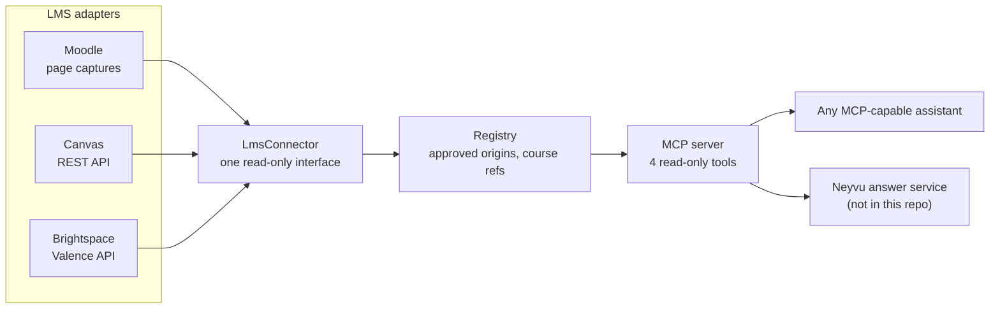

# Neyvu connector layer (prototype)

**Neyvu is one place for everything you need to learn.** It connects a learner's sources and answers three questions, always with the source shown: *which material is current, does it apply to me, and what do I do next?*

This repository is the part of Neyvu that reads learning platforms: one read-only interface with Moodle, Canvas and Brightspace adapters, and an MCP server on top. It runs entirely on **synthetic fixtures**. It is a prototype and is not connected to the live Neyvu product.

## The problem

A learner's course information is spread across a learning platform (Moodle, Canvas, Brightspace), public university pages and PDFs, school email, lecture recordings and their own photos and uploads. These sources often disagree, go out of date, or apply only to some sections. Students end up checking several places to find out what is current, what applies to them, and what to do next.

**Why not ChatGPT or Claude with an MCP connector?** In most cases students cannot connect an assistant to their learning platform themselves: we are not aware of an official vendor MCP server they can switch on, and some universities are disabling personal access tokens. A vendor's built-in agent sees only its own platform. Neyvu reads across sources and reasons about which version is current and whether it applies to a given learner, for example their lab section. Neyvu also offers its own read-only MCP connector, so assistants can use a learner's verified context instead of guessing.

## What this repository demonstrates

- **One interface for any platform.** `LmsConnector` (four read methods) has three implementations: Canvas (REST API v1), Brightspace (Valence API) and Moodle (page-capture records in the shape Neyvu's desktop Companion produces).
- **One MCP server for any assistant.** Four read-only tools (`list_courses`, `list_assignments`, `list_documents`, `get_document`) answer for all three platforms at once.
- **Provenance on every record.** Each course, assignment and document carries its source URL, the API path or capture it came from, the provider's version marker, a sha256 of the raw record and the time it was read.
- **Trust rules in code, not prompts.** Reads only, the learner's own courses only, no guessed due dates, and no inferred submissions or grades.



More detail: [docs/architecture.md](docs/architecture.md).

## Quick start

Requires **Node.js 22.18 or newer** (tested on 24.22). There are no dependencies and no install step; Node runs the TypeScript directly.

```bash
npm test           # 19 tests: contract suite x3 connectors, safety refusals, MCP end to end over stdio
npm run demo       # Canvas, Moodle and Brightspace through one interface
npm run demo:mcp   # the same listing, read as an MCP client of the server
npm run mcp        # start the MCP server on stdio
```

`npm run demo` (sample output, hashes shortened):

```text
== Canvas · sample-canvas · https://canvas.example.com
  DEMO 1010    Introductory Biology (sample)   [sample-canvas/101]
      - Lab 4: Enzyme kinetics report        due 2026-11-14 03:59 Z   sha256:3d1b364e739c…
      - Quiz 3 reading reflection            due 2026-11-19 16:00 Z   sha256:7d4239b9778a…
      - Optional study guide                 no due date   sha256:2bda3c63debe…
  ...
== Moodle · sample-moodle · https://moodle.example.com
  DEMO 1020    General Chemistry I (sample)   [sample-moodle/42]
      - Problem set 7                        due 2026-11-14 23:59 -04:00   sha256:5c99871a4ac1…
  ! Moodle data comes from pages the Companion captured, not a live Moodle API; anything not yet captured is missing.
  ! Some course sections are collapsed.

== Brightspace · sample-brightspace · https://learn.example.com
  DEMO 2030    Organizational Behaviour (sample)   [sample-brightspace/6606]
      - Team charter                         due 2026-11-18 03:59 Z   sha256:22fdcb7583ff…
      - Reflection journal 3                 no due date   sha256:1be433a7f439…
  ...
```

`npm run demo:mcp`:

```text
MCP server: neyvu-lms-connectors 0.1.0 (protocol 2025-06-18)
tools: list_courses, list_assignments, list_documents, get_document

== Moodle · sample-moodle
  DEMO 1020    General Chemistry I (sample)
      - Problem set 7                        due 2026-11-14 23:59 -04:00

== Canvas · sample-canvas
  DEMO 1010    Introductory Biology (sample)
      - Lab 4: Enzyme kinetics report        due 2026-11-14 03:59 Z
  ...
```

To try the server from an MCP client such as Claude Desktop or Claude Code, add it to the client's config:

```json
{"mcpServers": {"neyvu-lms-demo": {"command": "node", "args": ["/path/to/this/repo/src/mcp-server.ts"]}}}
```

## Adding a new platform adapter

1. **Add fixtures.** Create `fixtures/<platform>/` with synthetic responses in the shape the platform's public API documents: an `https://*.example.com` origin, a placeholder bearer value, the expected learner id, and a `responses` map keyed by path and query.
2. **Implement `LmsConnector`** in `src/connectors/<platform>.ts`. Use `ReadOnlyLms` from `src/read-only.ts` for HTTP, so you get GET-only requests, origin scoping, page budgets and short error codes for free. Then:
   - check the signed-in identity before listing courses (`identity_changed` on mismatch);
   - check that a course is in the learner's own enrollments before any course-scoped read (`boundary`);
   - pass every raw record through `provenance()`;
   - return `dueAt` only when the platform gives an explicit offset, otherwise `null` with `dueText`;
   - leave `submission` and `grade` as `'unverified'`.
3. **Register it.** Add the provider to the `Provider` type in `src/types.ts`, a branch in `src/registry.ts`, and an entry in `connectors.fixture.json`.
4. **Add it to the contract test.** Add the provider name to the loop at the top of `test/connectors.test.ts`; the same assertions then run against it. Add tests for its paging and any date quirks.

The MCP server and the demo need no changes: they only see `LmsConnector`.

## Design rules

- **Read-only.** Requests are GET only. The fixture fetch refuses any other method, and every MCP tool is annotated `readOnlyHint: true`. Neyvu reads sources and never writes to them.
- **Provenance on every item.** Source URL, read path, version marker, sha256 and observation time on every course, assignment and document.
- **No credentials through chat.** No MCP tool accepts a URL, username, password or token, and tool inputs reject unknown properties. Platform origins come from a reviewed registry, never from user input. In a live deployment, access would come from an institution-approved OAuth grant held on the server (not built here).
- **Fixtures only.** Every course, person, identifier and origin in this repository is synthetic (`*.example.com`, "Sample Learner", `DEMO` course codes). The placeholder bearer value is the literal string `fixture-token-not-a-real-credential`.
- **No guessed dates, no inferred outcomes.** A due time without an explicit zone is rejected or kept as text. A deadline is never treated as evidence of a submission or a grade.
- **Course material is data.** Document content is labelled `untrusted course material` so an assistant treats it as data, never as instructions.

## Status

- **This repository is a prototype over synthetic fixtures.** It has not been run against a live Canvas, Brightspace or Moodle site. The fixtures follow the platforms' public API documentation and were not recorded from a real tenant, so a real tenant may return fields or edge cases they do not cover.
- **The live Neyvu product today** reads Moodle at one university (Acadia University) through a desktop companion app. That product is separate from this repository; this connector layer is the route to other platforms and is not yet wired into it.
- **Known limits:** file bodies are listed but not downloaded; Brightspace topics return their description only; the Brightspace API versions are fixture values.

**What's next**

1. A Moodle connector using a mobile-service token, as a fourth adapter behind the same interface.
2. Read-only Outlook and Gmail connectors for school email.
3. Canvas and Brightspace through institution-approved OAuth.

## Repository layout

| Path | What it is |
|---|---|
| `src/types.ts` | The `LmsConnector` interface and record types |
| `src/connectors/` | Canvas, Brightspace and Moodle adapters |
| `src/read-only.ts` | GET-only HTTP core shared by the API adapters |
| `src/provenance.ts` | Canonical-JSON sha256 and the provenance builder |
| `src/registry.ts` | Builds connectors from `connectors.fixture.json` and resolves course refs |
| `src/mcp-server.ts` | MCP stdio server with four read-only tools |
| `src/fixture-fetch.ts` | `fetch` stand-in that answers only fixture GETs |
| `src/demo.ts` | The demo script |
| `fixtures/` | Synthetic platform responses |
| `test/` | `node:test` suites |
| `docs/architecture.md` | Diagram and interface reference |

## License

MIT. See [LICENSE](LICENSE).
