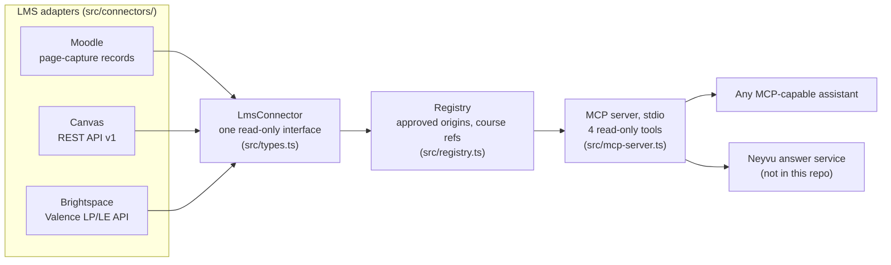

# Architecture: the connector layer

Every learning platform is read through one small, read-only TypeScript interface. Everything above that interface (the registry, the MCP server, the demo, and in the product the Neyvu answer service) talks only to the interface and never to a provider API.



In this repository every adapter reads synthetic fixtures (`fixtures/`). The Canvas and Brightspace adapters make real `fetch` calls, but `src/fixture-fetch.ts` answers them from fixture files and refuses any non-GET method, foreign origin or wrong bearer value.

## The interface

Defined in [`src/types.ts`](../src/types.ts):

```ts
interface LmsConnector {
  readonly id: string;          // registry name, prefix of every ref, e.g. "sample-canvas"
  readonly provider: 'moodle' | 'canvas' | 'brightspace';
  readonly origin: string;      // https origin from the approved registry
  listCourses(): Promise<Listing<Course>>;
  listAssignments(courseExternalId: string): Promise<Listing<Assignment>>;
  listDocuments(courseExternalId: string): Promise<Listing<DocumentRef>>;
  getDocument(courseExternalId: string, documentExternalId: string): Promise<DocumentContent>;
}
```

| Type | What it carries |
|---|---|
| `Listing<T>` | `items`, `complete` (false when a page budget or capture limit stopped the read), `issues` (plain-language coverage gaps) |
| `Course` | `ref` (`<connectorId>/<courseId>`), `externalId`, `code`, `title`, `provenance` |
| `Assignment` | `dueAt` (ISO 8601 with an explicit offset, or `null`), `dueText` (what the LMS displayed), `submission: 'unverified'`, `grade: 'unverified'`, `provenance` |
| `DocumentRef` | `kind` (`page`, `file`, `assignment-instructions`, `course-page`, `link`), `title`, `contentAvailable`, `provenance` |
| `DocumentContent` | a `DocumentRef` plus `role: 'untrusted course material'`, `format`, `content`, `contentSha256` |
| `Provenance` | `provider`, `sourceUrl` (the page a learner would open), `readFrom` (API path or capture), `version` (provider version marker or `null`), `contentHash` (sha256 of the canonical raw record), `observedAt` |

## Components

| Path | Role |
|---|---|
| `src/read-only.ts` | GET-only HTTP core: approved https origins only, path-prefix scoping, no redirects, size and page budgets, provider errors reduced to short codes |
| `src/provenance.ts` | Canonical JSON (sorted keys) and the sha256 provenance builder |
| `src/connectors/*.ts` | One adapter per platform; each maps provider records onto the shared types |
| `src/registry.ts` | Builds connectors from `connectors.fixture.json` and resolves `connector/course` refs to exactly one connector |
| `src/mcp-server.ts` | Newline-delimited JSON-RPC 2.0 over stdio: `initialize`, `ping`, `tools/list`, `tools/call` |
| `src/fixture-fetch.ts` | `fetch` stand-in for tests and the demo |

## MCP tools

| Tool | Input | Returns |
|---|---|---|
| `list_courses` | optional `connector` | courses from every connector, grouped, with provenance |
| `list_assignments` | `course_ref` | assignments with `dueAt`/`dueText`; submission and grade always `unverified` |
| `list_documents` | `course_ref` | pages, files, links, assignment instructions |
| `get_document` | `course_ref`, `document_id` | one document, labelled untrusted course material, with sha256 |

All four are annotated `readOnlyHint: true`, `destructiveHint: false`. Inputs reject unknown properties. No tool takes a URL, username, password or token. Errors come back as tool results with a short code (`boundary`, `not_found`, `reauthorize`, ...), never provider text.

## Safety checks every adapter must pass

The contract test in `test/connectors.test.ts` runs the same assertions against every connector: refs are well formed, every record has a sha256 provenance hash and a source URL on the connector's own origin, `dueAt` is offset-qualified or `null`, submission and grade stay `unverified`, every listed document can be fetched and its hash matches, and every request was a GET to the connector's own origin.
